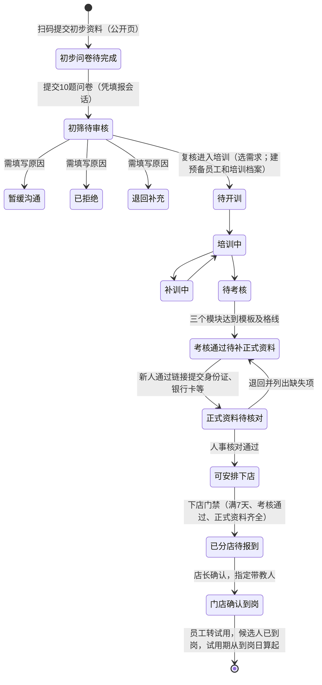

# 韩院长人事系统 · 全部菜单接通真实后端开发规划（目标版本 v5.4）

> 依据：`韩院长人事系统_v5.3.0-rc.1_完整源码与开发交接包_20260922-002612.zip` 中的前端源码（React，20 个菜单）、后端快照（FastAPI + SQLite，153 个接口）和交接文档。所有“现状”结论都来自对源码的逐页核对，不是根据文档推测。
>
> 本规划只涉及开发和测试；任何对腾讯云正式环境的部署、迁移、恢复，仍需用户书面确认“同意正式发布”。

---

## 0. 目标：什么叫“每个菜单都能正常使用”

一个菜单只有同时满足下面 8 条，才算完成：

| # | 验收条件 | 说明 |
|---|---|---|
| 1 | **数据来自后端** | 页面不再读 `DemoProvider` 内存数据；刷新、换电脑、换账号后数据一致 |
| 2 | **每个按钮都调用真实接口** | 新建、编辑、审批、流转、导入、导出、上传都写入数据库，并留下审计记录 |
| 3 | **权限由后端判定** | 没有权限时菜单和按钮隐藏；即使直接调用接口也返回 403 和中文原因；店长只看本店 |
| 4 | **并发安全** | 两人同时修改同一条记录时，后提交的人看到“已被他人更新，请刷新”（409），不会互相覆盖 |
| 5 | **四种状态齐全** | 加载中、空数据、出错（含中文原因与下一步）、维护中（503） |
| 6 | **手机可用** | 390px 宽度下所有操作可完成，没有横向滚动 |
| 7 | **自动化测试覆盖** | 后端接口测试 + 前端接口层单元测试 + 浏览器端到端（E2E）冒烟测试 |
| 8 | **去掉演示痕迹** | 删除“演示”“本次会话有效”等文案和写死的日期（如 `2026-09-20`） |

范围：20 个菜单 + 员工扫码填报页（`/self?code=`）+ 登录 / 改密 / 退出 + 数据备份恢复。

---

## 1. 现状快照（逐页核对结果）

### 1.1 两套系统，只有一处接通

- 前端 `src/`：20 个菜单、73 个页面状态，除“权限管理 → 数据备份与恢复”外，**全部读写浏览器内存**，刷新即重置；没有登录页，右上角“系统管理员”是写死的。
- 后端 `backend/app/`：约 9,400 行，153 个接口（7 个免登录），51 张表，覆盖了前端绝大多数业务。
- 前端新界面的业务阶段与后端**高度一致**，说明新界面就是按后端设计的，接通工作量可控：
  - 候选人 9 个状态（待核实 → 已到岗 / 不合适 / 中途放弃）与 `recruit.py` 的 `STATUS_LABELS` 一一对应；
  - 简历 9 个阶段与 `resume_service.py` 的 `WORKFLOW_LABELS` 一一对应；
  - 前端培训共 12 个状态，其中 9 个与 `training.py` 的 `T_STATUS` 一一对应，另外 3 个（考核通过待补正式资料、正式资料待核对、可安排下店）是前端新增的“正式资料门禁”；
  - 5 种角色、46 个共有权限项的默认授权，前后端完全一致（已用脚本逐项比对，差异 0）。

### 1.2 覆盖矩阵总览

| 分类 | 菜单 | 说明 |
|---|---|---|
| **后端已具备，前端直接接** | 门店管理、账号管理、招人需求、转正提醒、我的月度、人事专员绩效、预警中心 | 只需前端改造，加少量参数或校验 |
| **后端需小改** | 员工档案、招聘工作台、二维码中心、扫码表单配置、我的上报、招人分析、工作台、权限管理 | 补字段、补参数或补一两个接口 |
| **后端需新增能力** | 候选人跟进、新人培训中心、员工提交资料、扫码填报页、入职素质测评、老带新奖励 | 涉及统一入职流程、测评口径、介绍关系等新规则 |

### 1.3 后端已有、但 20 个菜单里没有入口的功能

人才库（`/api/talents/*`，含跟进、草稿、转招聘）、培训模板管理（`/api/training/templates`）、测评结果（`/api/quiz/admin/results`）、门店用人需求（`/api/training/store-needs`）、员工证件与附件历史、银行卡核对、健康证。这些功能**不能在切换后丢失**，安置方案见决策 D9。

---

## 2. 开工前必须由业务方拍板的决策

每一项都附推荐方案。**未拍板的决策会阻塞对应阶段**，见第 4 节依赖关系。

| 编号 | 问题 | 冲突来源 | 推荐方案 |
|---|---|---|---|
| **D1** | 新人培训期间算不算员工？ | 前端（`AGENTS.md` 已批准）：培训中是“预备员工”，门店确认到岗后才转试用。后端：建培训档案前必须先有员工档案，候选人到岗时直接建员工 | 员工表增加状态 `pre_employee`（预备员工）。复核“进入培训”时建预备员工和培训档案；**门店确认到岗时自动转为试用，试用期从实际到岗日算起**。复核时必须选择一个已批准的招人需求（候选人表要求必须关联需求，门店缺口和招聘分析都依赖它） |
| **D2** | 入职测评用哪套规则？ | 前端：10 题、6 个维度、60 分及格、75 分为整体匹配、关键题提示、不自动淘汰。后端：自由题库，没有维度，默认推荐线 80 分 | 以前端已批准的规则为准；后端题目增加“维度”和“关键题”标记，及格线和等级可配置，默认 60 / 75 |
| **D3** | 扫码“入职登记”第一步收哪些资料？ | 已批准方向：第一步只收基础联系、紧急联系人、住址和经验，然后做问卷。后端现有 `onboard` 表单一次收身份证、银行卡 | 第一步只收基础信息和问卷；身份证、银行卡、健康证放到“正式资料补全”（考核通过后发链接填写）。已印刷的二维码继续有效，过渡期两种字段集都接受 |
| **D4** | 工作上报能否修改或撤回？ | 后端设计为“原始记录不可改”；前端允许编辑和撤回 | 允许**撤回**（标记为已撤回，月度统计扣除，原记录保留）和**补充更正**（追加记录）；不允许覆盖原文。每条上报对应一件具体工作（可关联候选人），前端的“数量”字段取消 |
| **D5** | 老带新奖励谁能看、谁能发？ | 后端全部接口要求 `org.user_manage`，默认只有系统管理员 | 新增 `reward.view`、`reward.manage`、`reward.pay` 三项权限，默认授予总部和人事主管查看与管理，发放仅限管理员；页面显示“登记发放，不执行真实支付” |
| **D6** | 停用的二维码能否重新启用？ | 后端只能停用；前端可启用和停用 | 未过期的二维码允许重新启用，写入审计 |
| **D7** | 员工工号怎么来？ | 前端显示工号；后端员工表没有工号字段 | 新增 `employee_no`（文本、唯一、可空，保留前导零）；历史员工的补号规则由人事确认后一次性导入 |
| **D8** | 登录会话怎么保存？ | 后端只支持请求头里的令牌；交接文档要求不得把令牌存进浏览器持久存储 | 登录后由后端下发 HttpOnly + SameSite=Strict 的会话 Cookie，配合 CSRF 校验；保留请求头令牌方式，供旧界面在过渡期使用 |
| **D9** | 后端有、菜单没有的功能放哪？ | 见 1.3 | 人才库放进“招聘工作台”的标签页；培训模板放进“新人培训中心”的标签页；测评结果放进“入职素质测评”；健康证、证件历史、银行卡核对放在员工详情页 |
| **D10** | 人事专员绩效是否显示综合分？ | 前端写“综合分未启用计算”；后端 `/api/hr/score` 已能计算 | 只给主管看综合分和各维度明细，不做排名公示；专员只看自己的分数 |

---

## 3. 总体技术方案

### 3.1 前端分层

```
src/
  api/
    client.js         # 统一请求：同源、带 Cookie、自动附 CSRF 头、超时、错误转中文
    labels.js         # 状态码 ↔ 中文标签的唯一来源（与后端 *_LABELS 对齐）
    org.js  employees.js  training.js  recruit.js  resume.js  talents.js
    self.js  onboarding.js  quiz.js  hr.js  referral.js  alerts.js  analytics.js  backups.js
    adapters/         # 后端字段 ↔ 前端字段的转换（见 3.3）
  session.jsx         # SessionProvider：/api/auth/me、权限集合、can(perm)、角色、门店
  data/
    useResource.js    # 读：{data, loading, error, reload}
    useMutation.js    # 写：防重复提交、409 冲突提示、成功后刷新
  pages/
    Login.jsx         # 新增：手机号 + 密码，登录失败与限流提示
    ...               # 现有页面逐个把 useDemo() 换成 api/* + useResource
  menu-permissions.js # 菜单 → 所需权限（菜单过滤与 E2E 共用）
```

**`client.js` 的统一错误处理：**

| 状态码 | 处理 |
|---|---|
| 401 | 清除会话，跳转登录页，登录后回到原页面 |
| 403 | 提示后端给出的中文原因，不跳转 |
| 409 | 提示“已被他人更新，请刷新后重试”，并提供刷新按钮 |
| 413 / 422 / 400 | 显示后端返回的中文原因 |
| 429 | 显示“操作太频繁”，并按 `Retry-After` 倒计时 |
| 503 | 全局横幅“系统正在维护或恢复数据”，暂停写操作 |

**不引入新的状态管理库。** 保持当前依赖集合，在线入口脚本压缩后不超过 350 KB。`useResource` / `useMutation` 两个小钩子足够。

**演示模式的去留：** 迁移期间，`build:offline` 继续使用 `DemoProvider`。正式构建通过运行时开关排除演示数据。全部菜单迁完后，由业务决定是否保留离线演示包。

### 3.2 后端改造原则

- 沿用 `migrations.py` 的**只增不删**迁移方式：加列、加表、加状态值，不改旧列含义，保证旧界面在过渡期仍能运行。
- 新接口一律使用 `require_perm` + `assert_store`；修改类接口带 `revision` 或条件更新，防止并发覆盖；新建类接口支持 `request_id` 幂等（工作上报和人才跟进已有现成实现可复用）。
- 每个新增或修改的接口，先写 `backend/tests/test_<模块>_api.py`（沿用 `test_backup_api.py` 的临时 SQLite 写法）。

### 3.3 字段对照（适配层的唯一来源）

| 前端字段 | 后端字段 | 备注 |
|---|---|---|
| `store`（门店名） | `store_id` + `store_name` | 下拉框选项来自 `/api/org/stores` |
| `role`（岗位） | `position` | |
| `joinDate` / `probationMonths` | `joined_at` / `probation_months` | |
| `status`：试用中 / 正式 / 已离职 / 预备员工 | `probation` / `active` / `left` / `pre_employee` | `pre_employee` 为 D1 新增 |
| `identity` / `bankName` / `bankAccount` | `id_card` / `bank_name` / `bank`（另有 `bank_holder`、`bank_branch`） | 是否打码由后端决定，前端不再自行打码 |
| `code`（工号） | `employee_no` | D7 新增 |
| 二维码类型：入职登记 / 信息补全 / 证件补充 / 健康申报 / 离职交接 | `onboard` / `complete` / `doc` / `health` / `exit` | |
| 表单字段 `identity`、`bankCard`、`healthExpiry`、`qualification`、`temperature`、`symptoms`、`lastWorkDate`、`leavingReason` | `idCard`、`bank`、`healthCert`、`skillCert`、`temp`、`symptom`、`leaveDate`、`feedback` | 后端新增 `emergencyName`、`emergencyRelation`、`emergencyPhone`、`hasExperience`、`experienceType`、`experienceDuration`、`experienceProjects`；选项列表（性别、学历、症状）以后端为准统一 |
| 考核模块 `practice` | `technique` | 及格线以培训模板配置为准，前端写死的 80 / 85 / 80 删除 |
| 门店状态 在用 / 停用 | `active` 布尔值 | |

### 3.4 统一入职流程（D1–D3 拍板后，由后端负责状态判定）



一次状态变化要同时更新四张表：**入职案例、培训档案、候选人、员工**。这四处更新放在后端同一个数据库事务里完成，前端只调用一个动作接口。现有 `src/onboarding-flow.js` 的状态机作为**规则说明和测试用例来源**，在后端用 Python 重写为 `backend/app/onboarding_service.py`，前端不再自行判定状态。

---

## 4. 分阶段计划

工作量为粗估，按 1 名熟悉 React + FastAPI 的开发者计算，单位为人日。

| 阶段 | 内容 | 依赖 | 粗估 |
|---|---|---|---|
| P0 | 准备：只读核对、业务决策、测试环境、自动检查流程 | — | 2–3 |
| P1 | 地基：登录会话、接口层、权限菜单、安全修复 | P0 | 5–7 |
| P2 | 系统管理：门店、账号、权限（含岗位）、备份 | P1 | 3–4 |
| P3 | 员工：员工档案、转正提醒 | P1、D7 | 5–6 |
| P4 | 招聘：招人需求、招聘工作台（含人才库）、候选人跟进 | P3 | 7–9 |
| P5 | 入职链路：二维码、提交资料、表单配置、扫码填报、测评、新人培训 | P4、D1–D3 | 10–14 |
| P6 | 协同与分析：我的上报、我的月度、奖励、招人分析、绩效 | P1、D4、D5、D10 | 6–8 |
| P7 | 工作台、预警中心（汇总各模块数据，放最后做） | P2–P6 | 2–3 |
| P8 | 全量回归、隔离恢复演练、并行试运行、切换 | 全部 | 4–5 |
| | **合计** | | **约 44–59 人日** |

P6 只依赖 P1，可以与 P3–P5 并行，由第二名开发者承担。

### P0 准备（只读，不改任何线上内容）

1. **只读拉取线上旧界面**：`/opt/hanyuan-hr-r3/current/web/`、nginx 站点配置、`PRAGMA journal_mode`。逐项列出旧界面的菜单和按钮，与 20 个菜单对照，形成“旧功能 → 新位置”清单，确保没有功能丢失。
2. **D1–D10 业务签字**，结果写入 `AGENTS.md`。
3. **隔离联调环境**：
   - 用后端快照加空库启动（设置 `HYZ_DEV_BOOTSTRAP_*`）；
   - 新增 `backend/scripts/seed_fixture.py`，写入虚构的 5 家门店、各角色账号、员工、需求、候选人、培训和提交资料；
   - 测试账号：管理员、总部、人事主管、人事专员 ×2、A 店店长、B 店店长、绑定“培训主管岗”的培训师。
4. **自动检查流程（GitHub Actions）**：
   - 依次执行 `pnpm install --frozen-lockfile`、`pnpm build`、`pnpm test:demo`、`pnpm test:fusion`、`pnpm test:sites`（注意必须先构建再跑 Sites 测试），然后跑后端 `unittest`；
   - 再启动后端加种子数据，用 Playwright 跑 E2E（环境已预装 Chromium）。

### P1 地基

**后端**

- [ ] 会话：登录成功后下发 HttpOnly 会话 Cookie 和 CSRF Cookie；`current_user` 同时接受 Cookie 和请求头令牌；所有写请求校验 `X-CSRF-Token`；新增 `POST /api/auth/logout`。
- [ ] 安全修复（来自上一轮分析）：
  - [ ] 测评提交 `POST /api/quiz/public/answer` 改为凭填报会话令牌提交，不再接受裸的自增编号；
  - [ ] 备份恢复的回退副本改用 SQLite 备份接口，切换前清理旧的 `-wal` / `-shm` / `-journal` 文件；
  - [ ] 密钥指纹改为读取 `config.SECRET_KEY_PATH`；读取并校验 `HYZ_INSTANCE_ID`；
  - [ ] 清理 `restore-staging/`、`restore-rollback/` 临时目录；启动时检测并处理未完成的恢复；
  - [ ] 恢复前快照写入备份记录，使其在管理界面可见；
  - [ ] 生产环境关闭 `/api/docs` 和 `/api/openapi.json`；
  - [ ] 账号登录限流改为“失败才计数”，并加入 IP 维度。
- [ ] 权限：在 `seed.py` 中新增 14 项权限，并按 D2、D5 设置默认授权：
  - 测评 4 项：`assessment.own.view`、`assessment.all.view`、`assessment.detail.view`、`assessment.threshold.manage`；
  - 入职流程 5 项：`onboarding.review`、`onboarding.training.manage`、`onboarding.profile.verify`、`onboarding.store.assign`、`onboarding.arrival.confirm`；
  - 敏感信息 2 项：`sensitive.identity.reveal`、`sensitive.bank.reveal`；
  - 奖励 3 项：`reward.view`、`reward.manage`、`reward.pay`。

**前端**

- [ ] `api/client.js`、`session.jsx`、`useResource` / `useMutation`、`Login.jsx`、改密码弹窗、退出。
- [ ] 侧栏按 `menu-permissions.js` 过滤菜单；右上角显示真实姓名、角色和门店；删除“演示数据”徽标。
- [ ] 全局 503 维护横幅；全局 409 冲突提示组件。
- [ ] 删除所有写死的“今天”（`overview-model.js` 的 `DEMO_TODAY`、`People.jsx` 的 `TODAY`、工作台头部日期），统一使用服务器返回的日期（新增 `GET /api/health` 返回 `today`，时区 Asia/Shanghai）。

**验收**：7 类测试账号都能登录、退出、改密码；每个账号看到的菜单与权限矩阵一致；令牌不出现在 localStorage、sessionStorage 或网址中；P1 涉及的安全修复都有对应的后端测试。

### P2 – P7：逐菜单工作包

详见第 5 节。每个菜单都按下面的固定步骤迁移：

1. **补后端缺口**：先写接口测试（覆盖成功、403、店长跨店、409、输入错误），再写实现。
2. **写 `api/<模块>.js` 和适配器**：单元测试使用真实接口响应保存下来的样例数据。
3. **改页面**：把 `useDemo()` 换成 `useResource` / `useMutation`；保持组件结构和 Hash 路由不变（例如 `#employees?view=detail&id=12` 仍然可用）。
4. **按钮级权限**：用 `can('xxx')` 控制显示；服务器返回 403 时显示原因。
5. **补齐状态**：加载、空数据、错误、409 冲突、503 维护。
6. **E2E**：写本菜单的冒烟测试和关键操作测试，按角色各跑一遍。
7. **更新覆盖矩阵**：在 `docs/menu-api-matrix.md` 中把该菜单标为“已接通”。

### P8 回归与切换

1. **全量 E2E**：20 个菜单 × 7 类账号的权限矩阵，加 5 条跨模块主流程（见 6.3）。
2. **隔离恢复演练**：在正式库结构的副本上执行“备份 → 清空 → 恢复 → 逐表行数、附件哈希、主流程比对”，保存不含敏感信息的报告。
3. **并行试运行**：
   - 新界面部署到 `/hr/next/`，旧界面仍在 `/hr/`；
   - 后端改动全部只增不删，旧界面不受影响；
   - 选 1–2 家门店试用 1–2 周，收集问题。
4. **切换**：
   - 取得“同意正式发布”授权；
   - 执行发布前完整快照，用新界面替换 `web/`；
   - 保留 `/self` 和 `/mobile` 地址，已印刷的二维码继续可用；
   - 准备回退方案：恢复旧 `web/` 目录 + 后端回退版本 + 发布前快照。

---

## 5. 逐菜单工作包

每个菜单列出四项：**现状**（前端演示里有哪些功能）、**接口**（后端已有）、**缺口**（需要新增或修改）、**验收**（必须通过的测试）。

### 5.1 系统管理（P2）

#### 门店管理 `#stores`

- **现状**：列表、按状态筛选、搜索、新建、编辑、启用 / 停用。
- **接口**：`GET/POST /api/org/stores`、`PUT /api/org/stores/{id}`（`org.store_view` / `org.store_manage`）。
- **缺口**：
  - 后端补“门店编号唯一”校验（目前只校验名称唯一）；
  - 启用 / 停用对应 `active` 字段；
  - 停用门店时提示仍有在职员工和有效二维码的数量。
- **验收**：编号重复返回 400 中文提示；店长账号看不到“新建门店”按钮，直接调接口返回 403；停用后该门店的二维码打开时提示“这家门店已停用”。

#### 账号管理 `#accounts`

- **现状**：列表、筛选、新建、编辑、启用 / 停用，岗位显示“待源码核对”。
- **接口**：`GET/POST /api/org/users`、`PUT /api/org/users/{id}`、`GET /api/org/positions`。
- **缺口**：
  - 岗位下拉框使用后端已有的 7 个岗位：人事专员岗、培训主管岗、运营经理岗、店长岗、副店长岗、头疗组长岗、前台组长岗；
  - 编辑时的密码框不回填；留空表示不修改（后端约定传 `________` 表示不改）；
  - 管理员重置他人密码后，对方现有会话自动失效（已由令牌中的密码版本号保证）。
- **验收**：不能停用最后一个管理员；店长账号必须绑定门店；非管理员不能创建管理员账号。

#### 权限管理 `#permissions`

- **现状**：角色权限矩阵（57 项）、岗位标签页为占位、备份标签页。
- **接口**：`GET /api/permissions`、`PUT /api/permissions/roles/{role}`、`PUT /api/permissions/positions/{id}/permissions`。
- **缺口**：
  - 矩阵数据改为从后端读取，不再使用前端写死的 57 行；
  - 岗位标签页实现为“岗位 × 权限”矩阵；
  - 保存时显示变更条数，并写入审计；
  - 依赖 P1 新增的 14 项权限。
- **验收**：撤销某角色的权限后，该角色账号刷新页面即看不到对应菜单，调接口返回 403；管理员行固定全选，不可修改。

#### 数据备份与恢复（权限管理的标签页）

- **现状**：网关已接通。
- **缺口**：改用 P1 的 Cookie 会话（删除 `window.__HYZ_HR_GATEWAY__` 注入方式）；创建备份和恢复后轮询任务状态直到结束；显示恢复前快照。
- **验收**：非 `backup.manage` 账号看不到该标签页；恢复期间其他页面显示维护横幅。

### 5.2 员工（P3）

#### 员工档案 `#employees`

- **现状**：统计卡片、待办提醒（资料待补齐、待转正）、筛选、搜索、新建、编辑、离职、Excel 导入（实际是本地 CSV 解析）、头像、附件、证书。
- **接口**：`GET/POST /api/employees`、`GET/PUT /api/employees/{id}`、`POST .../leave`、`GET .../history|files|materials`、`POST .../files`、`POST .../bank-verify`、`GET/POST .../health-cert`、`POST /api/employees/import`、`POST /api/attachments/upload`、`GET /api/attachments/...`。
- **缺口**：
  - 新增 `employee_no` 工号字段（D7）；
  - 支持按手机号搜索：手机号是加密存储，无法直接模糊查询，需新增 `phone_lookup` 哈希列，参照 `candidates` 表现有写法。这一列同时用于建档查重：现在的查重会解密全部在职员工的手机号，人多时会变慢；
  - 增加身份证号查重（后端目前只检查“同店同名”和手机号）；
  - 列表接口增加 `focus` 参数（在职 / 试用期 / 待转正 / 资料待补齐），并返回每人缺少的资料项；
  - 导入改为把 xlsx 原文件上传给后端处理，提供模板下载；
  - 敏感字段是否打码由后端决定；
  - 详情页新增“证件与附件历史”“银行卡核对”“健康证”区块（D9）；
  - 编辑时提交 `revision`，用于并发保护。
- **验收**：
  - 店长只能看到本店员工，身份证和银行卡打码；
  - 同店同名、重复手机号或重复身份证号建档被拒绝（409）；
  - 已离职员工不能重复办理离职；
  - 两个窗口同时编辑同一员工时，后保存者看到 409；
  - 导入错误逐行列出原因。

#### 转正提醒 `#probation`

- **现状**：待办理 / 已转正标签、即将到期 / 已逾期 / 等店长评价筛选、店长评价、确认转正。
- **接口**：`GET /api/employees/probation/list`、`GET .../{id}/evals`、`POST .../{id}/eval`、`POST .../{id}/decide`。
- **缺口**：
  - 后端已支持“延长试用期”（累计不超过 6 个月）和“不继续”，前端补上这两个选项；
  - 店长评价改用后端的三项评分（态度 / 技能 / 反馈，每项选“好 / 一般 / 待提高”）加建议；
  - 不需要新增接口。
- **验收**：累计延长超过 6 个月时提示最多还能延长几个月；店长不能做转正决定（403）；转正后员工状态变为“正式”。

### 5.3 招聘（P4）

#### 招人需求 `#demands`

- **现状**：列表、筛选、提需求、批准、驳回（需填原因）。
- **接口**：`GET/POST /api/recruit/needs`、`POST /api/recruit/needs/{id}/approve`（批准或驳回）。
- **缺口**：
  - 需求详情显示已到岗人数和缺口，后端在列表中返回；
  - 店长只能为本店提需求（后端已有 `assert_store`）。
- **验收**：已处理的需求不能再次审批；驳回必须填写原因；批准后工作台和预警中心的“门店缺口”同步变化。

#### 招聘工作台 `#recruitment`（含人才库标签页，D9）

- **现状**：简历列表（9 个阶段）、渠道概览、图表、看板、导入简历（前端解析 CSV / XLSX）、快速录入、批量加入人才库、批量分配负责人、重复简历人工确认。
- **接口**：
  - `/api/recruit/resume-inbox` 系列：列表、导入（支持 xlsx / csv / pdf / 图片多文件上传，也支持 JSON 单条录入）、详情、修改、确认、头像、重复判定、关联人才、关联候选人、批量分配、归档；
  - `/api/talents/*`；
  - `/api/analytics/recruit`。
- **缺口**：
  - 导入改为上传原文件，由后端解析和查重；前端解析仅保留为预览，或直接删除以减小体积；
  - 招人分析接口增加按来源统计（`by_source`），供渠道概览使用；
  - 新增批量“加入人才库”接口，或前端逐条调用 `link-talent`；
  - 人才库标签页接入跟进、草稿、转入招聘等现有接口。
- **验收**：
  - 同一文件重复导入不会生成重复简历（按批次 `batch_key` 和文件哈希判重）；
  - 疑似重复简历必须人工决定后才能进入流程；
  - 店长只能看到意向门店为本店的简历；
  - 人事专员只能看到分配给自己的简历，除非拥有 `talent.manage`。

#### 候选人跟进 `#candidates`

- **现状**：阶段筛选、测评筛选（待复核 / 低于 60 分 / 关键题需确认）、详情、编辑、负责人与下次联系、跟进记录、阶段变更、附件、测评复核（进入培训 / 暂缓 / 不合适）、办理入职。
- **接口**：`GET/POST /api/recruit/candidates`、`POST .../{id}/move`、`GET .../{id}/events`、`POST /api/talents/from-candidate/{id}`。
- **缺口（后端新增）**：
  - `candidates` 表加列：`owner_id`、`next_contact`、`next_note`、`onboarding_case_id`；
  - `PUT /api/recruit/candidates/{id}`：修改基本资料，带 `revision`；
  - `POST /api/recruit/candidates/{id}/followups`：只记录跟进、不改变阶段，写入 `recruit_events`；
  - 列表增加 `assessment=review|low|critical` 和 `owner=me` 筛选；
  - 测评复核调用 5.4 节的入职案例接口；
  - 录入候选人时必须选择一个已批准的需求；没有对应需求的人放进人才库。
- **验收**：
  - 不允许跳阶段流转（例如“待核实”不能直接变为“已到岗”）；
  - 未签合同不能标记到岗；
  - 两人同时流转同一候选人，后提交者看到 409；
  - 店长只能看本店候选人；
  - 复核选择暂缓或不合适时必须填写原因。

### 5.4 入职链路（P5，依赖 D1–D3）

#### 后端新增：统一入职流程 `backend/app/onboarding_service.py` 与 `routers/onboarding.py`

**新表 `onboarding_cases`**

| 字段 | 说明 |
|---|---|
| `id`、`status`、`revision` | 主键、状态、版本号 |
| `submission_id`、`candidate_id`、`employee_id`、`training_id` | 关联扫码提交、候选人、员工、培训档案 |
| `need_id`、`owner_id` | 关联招人需求、负责招聘官 |
| `initial_profile_enc`、`full_profile_enc` | 初步资料、正式资料（加密存储） |
| `quiz_result_id` | 关联测评结果 |
| `review_reason` | 复核原因 |
| `created_at`、`updated_at` | 时间戳 |

**新表 `onboarding_events`**：记录每一步的执行人、执行前状态、执行后状态、原因和时间。

**新接口**

| 接口 | 权限 | 作用 |
|---|---|---|
| `GET /api/onboarding/cases` | `onboarding.review` 或 `assessment.own.view` | 列表；人事专员只看自己负责的 |
| `GET /api/onboarding/cases/{id}` | 同上 | 详情、资料缺失项、测评摘要 |
| `POST /api/onboarding/cases/{id}/review` | `onboarding.review` | 进入培训 / 暂缓 / 不合适 / 退回（选“进入培训”时必须选择需求） |
| `POST /api/onboarding/cases/{id}/profile-link` | `onboarding.profile.verify` | 生成正式资料填写链接（一次性、有效期 7 天） |
| `POST /api/onboarding/cases/{id}/verify-profile` | `onboarding.profile.verify` | 核对通过，或退回并列出缺失项 |
| `POST /api/onboarding/cases/{id}/withdraw` | `onboarding.review` | 记录候选人主动放弃 |
| `GET /api/self/public/profile/{token}` | 公开 | 正式资料填写页读取表单 |
| `POST /api/self/public/profile/{token}/submit` | 公开 | 提交正式资料（附件沿用现有上传会话机制） |

**修改现有接口**

| 接口 | 修改内容 |
|---|---|
| `POST /api/self/public/task/{code}/submit` | 入职登记类型改为创建入职案例，状态为“初步问卷待完成”，同时返回问卷令牌 |
| `POST /api/quiz/public/answer` | 凭问卷令牌提交；成绩由服务器计算，不信任前端分数 |
| `POST /api/training/{id}/place` | 增加下店门禁：满 7 天、考核通过、正式资料齐全 |
| `POST /api/training/{id}/confirm-onboard` | 同一事务内：员工 `pre_employee` → `probation`、`joined_at` = 实际到岗日、候选人 → 已到岗、入职案例 → 门店确认到岗。沿用“未签合同不能到岗”规则：候选人还没有“合同生效”记录时拒绝，并提示先登记合同 |

**新增员工状态 `pre_employee` 的连带修改**：后端约有 16 处查询用 `status != "left"` 或 `status == "probation"` 判断“在职”或“试用”，分布在 `employees.py`、`recruit.py`、`self_service.py`、`hr.py`、`analytics.py`、`referral.py`、`alerts.py`。必须逐处确认是否排除预备员工（在职人数、转正提醒、门店人数、老带新结算、预警），并为每处补测试，否则预备员工会被误算为在职或进入转正提醒。
| `trainings_v2.status` | 新增 `profile_pending`、`profile_review`、`ready` 三个状态 |

**测试**：把 `tests/onboarding-flow.test.mjs` 中的每一条用例改写为后端测试，确保前后端规则一致：每个合法动作、每个非法状态、每个角色拒绝、版本冲突。

#### 扫码填报页 `/self?code=XXX`（新界面内部路由 `#publicform`）

- **现状**：初步资料 → 10 题问卷 → 正式资料（演示）。
- **接口**：`GET /api/self/public/task/{code}`、`POST .../upload`、`POST .../submit`、`GET /api/form-schemas/{type}`、`/api/quiz/public/*`。
- **缺口**：
  - 后端把 `/self` 指向新界面入口，并自动进入填报模式；
  - 填报会话令牌只放在页面内存中；
  - 问卷题目来自后端；
  - 正式资料页凭一次性链接访问；
  - 保留现有限流；
  - 提交后只显示“已提交，等待人事联系”，不显示分数。
- **验收**：
  - 已印刷的旧二维码能打开；过期或停用的二维码给出中文提示；
  - 同一会话不能重复提交；
  - 他人无法凭编号替别人交卷；
  - 手机微信内置浏览器可完成全流程。

#### 二维码中心 `#qrcodes`

- **现状**：生成、停用 / 启用、设为常用、复制链接、生成分享图（Canvas）。
- **接口**：`GET/POST /api/self/tasks`、`POST .../{id}/pause`、`GET .../{id}/qrcode`、`GET .../{id}/link`。
- **缺口**：
  - 新增 `POST /api/self/tasks/{id}/resume`（D6）；
  - 分享图中的二维码必须编码后端返回的链接（`/self?code=`），不能用前端拼的 `#publicform` 地址；
  - “设为常用”属于个人偏好，按用户编号存在本机即可，不需要后端。
- **验收**：店长只能为本店生成二维码；停用后扫码提示已停用；重新启用写入审计。

#### 员工提交资料 `#submissions`

- **现状**：列表、认领、核对、收进档案、退回补充、完整性检查、显示测评结果、核对正式资料。
- **接口**：`GET /api/self/submissions`、`POST .../{id}/claim`、`GET .../{id}`、`POST .../{id}/archive`、`POST .../{id}/return`。
- **缺口**：
  - 详情接口返回缺失项清单（按表单配置计算）；
  - 入职登记类提交显示入职案例和测评摘要（按测评权限过滤）；
  - 正式资料核对调用 `verify-profile`；
  - 收档前的重复员工检查在后端完成；
  - 收档和退回前必须先认领：后端目前只在“他人已认领”时拦截，没有认领也能直接处理，需补上。
- **验收**：未认领不能处理；他人已认领时只有主管能接管；资料缺项时不能收档，并显示缺失清单；已处理的记录不能重复收档（409）。

#### 扫码表单配置 `#formconfig`

- **现状**：5 种类型，每个字段可设“启用 / 必填”，附件可设“启用 / 必填”。
- **接口**：`GET/PUT /api/form-schemas/{type}`（`form.manage`）。
- **缺口**：
  - 后端 `fields` 支持 `[{key, required}]` 格式，同时兼容旧的纯字段名列表；
  - 按 3.3 节对照表统一字段名，补充 7 个新字段；
  - 按 D3 调整入职登记的默认字段。
- **验收**：修改配置后，新打开的填报页立即生效；必填字段未填时后端拒绝提交；旧格式配置仍能正确读取。

#### 入职素质测评 `#assessment`

- **现状**：题库（维度、启用 / 停用）、达标线与等级、结果列表、作答详情、按维度汇总分析。
- **接口**：`/api/quiz/admin/questions` 增删改、`PUT /api/quiz/admin/config`、`GET /api/quiz/admin/results`、`GET /api/quiz/admin/results/{id}`。
- **缺口**：
  - 题目加列 `dimension`、`critical`；配置加 `threshold`、`strong_threshold`、`levels`；结果加 `dimension_scores`、`critical_answers`、`owner_id`、`onboarding_case_id`；
  - 权限从 `org.user_manage` / `self.submission_view` 改为 `assessment.*` 系列；
  - 新增 `GET /api/quiz/admin/analytics`，返回按权限过滤后的汇总；
  - 导入前端的 10 道默认题。
- **验收**：
  - 人事专员只能看自己负责候选人的结果；
  - 店长只能看到分店后的最小必要摘要；
  - 修改题目不影响已提交答卷的快照；
  - 低于及格线只做提示，不自动淘汰。

#### 新人培训中心 `#training`（含模板标签页，D9）

- **现状**：统计、待办分组、列表、导出 CSV、新建培训、开训、每日记录、考核、补资料链接、核对、分店、到岗确认、终止；“门店用人”入口。
- **接口**：`/api/training/*` 全套 23 个接口，包括模板、档案、每日记录、考核、补训 / 终止申请、门店用人、分店、到岗确认、改店。
- **缺口**：
  - 3 个新状态和下店门禁（见本节开头）；
  - 导出 CSV 改用列表接口的数据；
  - 带教人从账号列表中选择；
  - 模板管理标签页；
  - 新建培训只能选择预备员工或员工；
  - 确认到岗的权限按 `training.store_confirm` / `onboarding.arrival.confirm` 校验，并限定为接收门店。
- **验收**：
  - 不满 7 天或考核未通过时不能分店；
  - 只有接收门店的店长能确认到岗；
  - 确认到岗后员工档案显示“试用中”、入职日为到岗日；
  - 改店会释放名额。

### 5.5 协同与分析（P6，可与 P3–P5 并行）

#### 我的上报 `#reports`

- **现状**：立即上报、编辑、撤回、按月筛选、主管核对证明。
- **接口**：`GET/POST /api/hr/work-logs`、`GET .../{id}`、`POST .../{id}/review`、`POST .../{id}/supplement`、`POST /api/hr/upload-photo`、`GET /api/hr/my-summary`。
- **缺口**：
  - 新增 `POST /api/hr/work-logs/{id}/withdraw`（D4），审核状态增加 `withdrawn`；
  - 前端“编辑”改为“补充更正”；
  - 去掉“数量”字段，可关联候选人；
  - 上报类型对照：面试 → `interview`，签约 → `sign`，下店 → `onboard`。
- **验收**：撤回后月度完成数立即扣减，原记录可查；重复提交（相同 `request_id`）不会生成两条；只有主管能核对证明。

#### 我的月度 `#monthly`

- **接口**：`GET /api/hr/monthly-progress`、`GET /api/hr/targets`、`GET /api/hr/my-summary`。
- **缺口**：无新增接口；目标为 0 时显示“未设置”，不显示 0%。
- **验收**：专员只能看自己的；主管能切换查看任意专员。

#### 老带新奖励 `#rewards`

- **现状**：方案、介绍关系、奖励台账、结算扫描、登记发放。
- **接口**：`/api/referral/referrers`（含 `sync`、`eligible`）、`plans`、`rewards`（含 `pay`、`clawback-done`）、`settle`。
- **缺口**：
  - **后端没有任何创建介绍关系的代码**（`ReferralLink` 只有表定义），所以结算扫描永远算不出奖励。需新增 `GET/POST /api/referral/links`，校验新人和介绍人都存在、同一新人只能有一个介绍人；
  - 权限按 D5 改造；
  - 前端的“手工登记奖励”改为由结算扫描生成，如需调整则走“调整记录 + 原因”；
  - 金额统一保留两位小数。
- **验收**：新人离职后，未发奖励停发、已发奖励标记待追回；重复结算不产生重复奖励；非授权账号看不到菜单。

#### 招人分析 `#analytics`

- **接口**：`GET /api/analytics/recruit?days=`、`GET /api/analytics/manager`。
- **缺口**：增加按来源统计 `by_source` 和自定义起止日期；样本少于 5 时显示“样本不足”（后端已返回 `sample` 字段）。
- **验收**：店长只看本店；漏斗各阶段人数与候选人列表筛选结果一致。

#### 人事专员绩效 `#performance`

- **接口**：`GET/POST /api/hr/targets`、`GET/PUT /api/hr/score-dims`、`GET /api/hr/score`、`GET /api/hr/specialists`。
- **缺口**：按 D10 显示综合分，主管可见、专员只看自己；维度权重合计必须为 100%（后端已校验，前端在保存前同步提示）。
- **验收**：专员调用其他人的评分接口返回 403；修改维度后综合分重新计算。

### 5.6 工作台与预警中心（P7，最后做）

#### 工作台 `#dashboard`

- **接口**：
  - `GET /api/analytics/overview`：4 个统计数字；
  - `GET /api/alerts`：风险雷达；
  - `GET /api/alerts/stores/overview`：门店状态。
- **缺口**：
  - 新增 `GET /api/activity?limit=5`：最近处理记录，从审计日志读取，按权限和门店过滤，只返回摘要，不含敏感信息；
  - 测评复核三项计数（待复核、低于 60 分、关键题需确认）使用 `onboarding/cases` 的计数参数；
  - “今日任务”中的数字全部来自上述接口。
- **验收**：每个数字与点进去后的列表条数一致（E2E 逐项比对）；店长只看本店。

#### 预警中心 `#alerts`

- **接口**：`GET /api/alerts`、`GET /api/alerts/exceptions`、`GET /api/alerts/stores/overview`、`POST .../{kind}/{id}/dismiss`（7 天内不再提示）、`POST .../{kind}/{id}/handle`（仅健康证）。
- **缺口**：
  - “健康证 30 天内到期”目前显示“待核实”，改用门店概览中的真实计数；
  - 健康证预警的“处理”使用 4 种结果（已续办 / 已预约 / 无需处理 / 误报）；
  - 其他预警的“处理”为跳转到对应业务页；
  - 合同到期在后端是占位值 0，界面标注“未接入”。
- **验收**：延后后 7 天内不再出现；店长只能处理本店预警。

---

## 6. 测试计划

### 6.1 后端

- 每个路由模块一个测试文件 `backend/tests/test_<模块>_api.py`，使用临时 SQLite 和种子数据。
- 每个接口至少覆盖：成功、未登录 401、无权限 403、店长跨店 403、输入错误 400 / 422、并发冲突 409。
- 入职流程状态机用表驱动测试，遍历所有“状态 × 动作 × 角色”组合。
- 权限回归：遍历 5 个角色 × 全部接口，对照 `ROLE_PERM_DEFAULTS` 断言允许或拒绝，防止以后改权限时漏改接口。

### 6.2 前端

- `api/*.js` 和适配器的单元测试（`node --test`，用伪造的请求函数）。
- 现有 `test:demo` 和 `test:fusion` 中依赖演示数据的检查，在对应菜单迁移后改为基于样例数据，或者删除并说明原因；**不能为了让测试通过而跳过**。

### 6.3 端到端（Playwright，真实后端 + 种子数据）

- **菜单冒烟**：20 个菜单 × 7 类账号，检查菜单可见性、页面能打开、无报错、手机 390px 无横向滚动。
- **5 条跨模块主流程：**
  1. 店长提需求 → 主管批准 → 导入简历 → 核实 → 面试 → 面试通过 → 签合同 → 培训 → 到岗 → 工作台和预警中心的门店缺口各减少 1；
  2. 扫码初步登记 → 问卷 → 复核进入培训 → 7 天记录 → 考核 → 补正式资料 → 核对 → 分店 → 登记合同 → 店长确认到岗 → 员工档案显示“试用中”，入职日为到岗日；
  3. 转正：店长评价 → 总部延长 1 个月 → 再评价 → 转正；
  4. 工作上报 → 主管要求补证明 → 补充 → 核对 → 撤回另一条 → 月度数字正确；
  5. 介绍关系 → 新人到岗满 N 天 → 结算生成奖励 → 发放 → 新人离职 → 标记待追回。

---

## 7. 风险与对策

| 风险 | 对策 |
|---|---|
| 旧界面有新界面没覆盖的功能，切换后丢失 | P0 只读拉取旧 `web/`，逐项对照；并行试运行期间收集反馈 |
| 后端改动影响仍在运行的旧界面 | 只增不删；过渡期接口同时接受新旧两种字段；旧界面加入 E2E 冒烟 |
| 已印刷的二维码失效 | 保留 `/self?code=` 地址；切换前后各测一次真实的旧二维码 |
| 统一入职流程规则理解偏差 | D1–D3 书面签字；把前端状态机测试改写为后端测试，作为验收依据 |
| 恢复功能本身有缺陷 | P1 先修复已发现的问题；P8 在隔离副本上演练，未通过不发布 |
| 工作量超出预估 | P6 交给第二名开发者并行；P5 可按“公开填报 → 复核 → 培训门禁”拆成三次交付 |

---

## 8. 第一周可以立即开始的任务

1. P0-1：只读拉取线上旧界面和 nginx 配置，产出“旧功能 → 新位置”清单。
2. P0-2：把 D1–D10 整理成一页给业务方签字。
3. P0-3 / P0-4：建立种子数据脚本和 GitHub Actions 自动检查流程。
4. P1 后端：会话 Cookie + CSRF、测评令牌修复、备份恢复修复，这些不依赖任何业务决策。
5. P1 前端：接口层、登录页、按权限过滤菜单。
6. P2：门店管理作为第一个完整迁移的菜单，用来验证整套迁移步骤和 E2E 写法。
